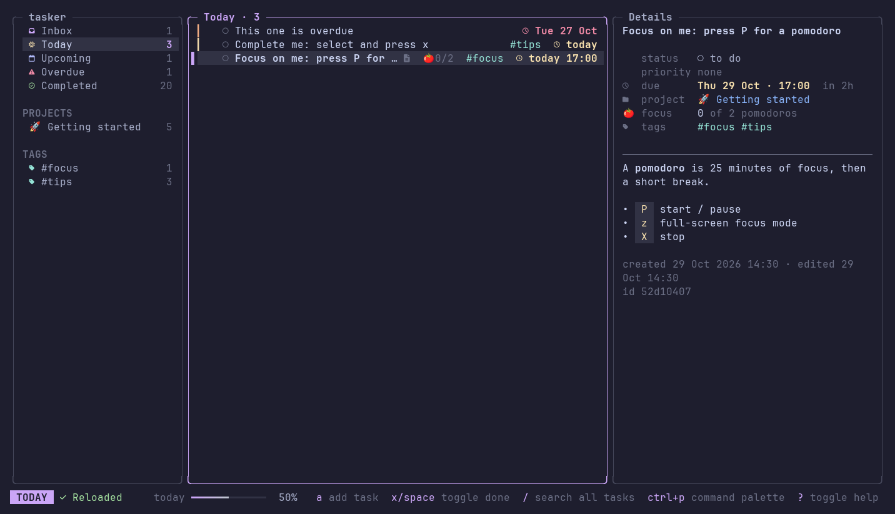
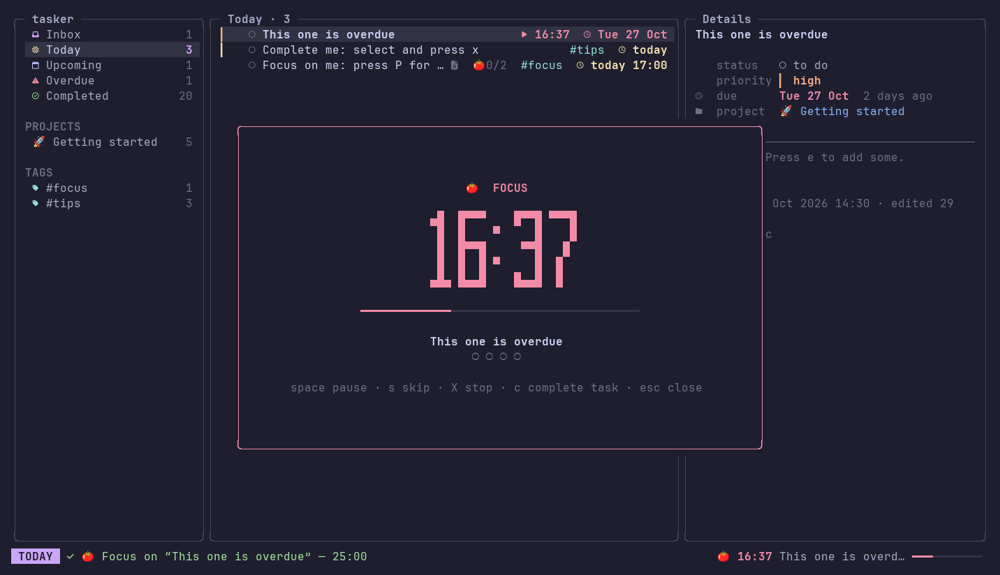
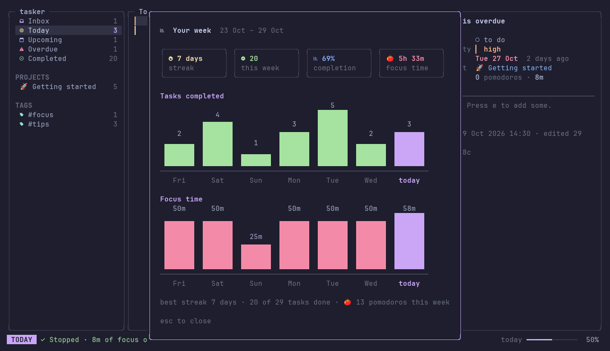
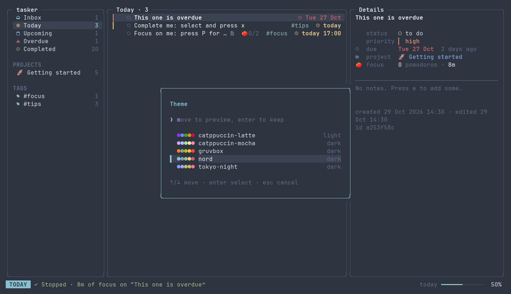

# tasker

A fast, keyboard-driven task manager for the terminal: smart views, projects,
tags, subtasks, natural-language due dates, a Pomodoro focus timer, five themes
and a scriptable CLI. One static binary, no CGO, your data in a local SQLite file.

Built with Go and [Charm](https://charm.sh) (Bubble Tea, Bubbles, Lip Gloss,
Huh, Glamour).



| Focus mode | Stats | Live theme preview |
|---|---|---|
|  |  |  |

<!-- An animated demo can be recorded with `make demo` (needs vhs). -->

## Features

- **Smart views**: Inbox, Today (includes overdue), Upcoming, Overdue,
  Completed, plus every project and tag, all with live counts.
- **Fast capture**: `tomorrow 5pm`, `next fri`, `in 3 days` just work.
- **Subtasks** with progress (`2/5`), **priorities**, **tags**, **markdown notes**.
- **Detail pane**, fuzzy **search** (`/`), **filters**, **sorting**, manual
  reordering, and a **command palette** (`Ctrl+P`) with every action.
- **Undo** (`u`) for completes, edits, moves and deletes, up to 50 steps.
- **Pomodoro timer** tied to tasks, with estimates, breaks, desktop
  notifications and a full-screen focus mode.
- **Stats**: streaks, completion rate, tasks and focus time per day.
- **Themes**: Catppuccin Mocha & Latte (light), Tokyo Night, Gruvbox, Nord,
  previewed live and saved to your config.
- **Responsive**: three panes on wide terminals, one at a time on narrow ones.
- **Scriptable CLI** with `--json` everywhere, plus JSON export/import.
- Built for **sync later**: UUIDs, timestamps and soft deletes on every record.

## Install

**Go** (1.26+):

```sh
go install github.com/mahm0udnasr/tasker@latest
```

**From source**:

```sh
git clone https://github.com/mahm0udnasr/tasker && cd tasker
make install        # → $(go env GOPATH)/bin/tasker
```

**Debian/Ubuntu package**: download the `.deb` from the
[releases page](https://github.com/mahm0udnasr/tasker/releases), then:

```sh
sudo apt install ./tasker_*_amd64.deb
```

For icons, use a [Nerd Font](https://www.nerdfonts.com) in your terminal, or
set `icons = "ascii"`. Desktop notifications use `notify-send`
(`sudo apt install libnotify-bin` if it's missing).

## Getting started

Run `tasker`. The first time, a welcome screen offers a few example tasks
that show off each feature. Press `?` at any time for every shortcut.

## Keybindings

All keys are vim-style by default and can be rebound in the config.

| Navigate | | Tasks | |
|---|---|---|---|
| `j` / `k` | move down / up | `a` | add task |
| `g` / `G` | top / bottom | `A` | add subtask |
| `Ctrl+D` / `Ctrl+U` | page down / up | `e` | edit task |
| `h` / `l` | focus left / right pane | `x` / `Space` | toggle done |
| `Tab` / `Shift+Tab` | cycle panes | `i` | toggle in progress |
| `Enter` | expand subtasks | `d` | delete task |
| `v` | toggle detail pane | `p` | cycle priority |
| | | `t` | set due date |
| **Find & organize** | | `m` | move to project |
| `/` | search all tasks | `J` / `K` | move task down / up (manual sort) |
| `Ctrl+P` or `:` | command palette | `D` | delete selected project |
| `f` / `F` | filter / clear filter | | |
| `s` | cycle sort | **Pomodoro** | |
| `u` | undo | `P` | start / pause |
| | | `X` | stop |
| **General** | | `>` | skip to next phase |
| `S` | stats | `z` | focus mode |
| `T` | change theme | | |
| `Ctrl+R` | reload | | |
| `?` | help | | |
| `q` | quit | | |

In the add/edit form: `Tab`/`Shift+Tab` move between fields, `Ctrl+S` saves,
`Esc` cancels. Adding from a view pre-fills it: due "today" in Today, the
project when a project is selected, the tag when a tag is.

## Pomodoro

Select a task and press `P` to start a 25-minute focus session on it. The
countdown shows in the status bar, on the task's row, and in the terminal's
tab/taskbar progress indicator where supported. Press `z` for focus mode.

- When a session ends you get a desktop notification and a bell, and a break
  starts: 5 minutes, or 15 after every 4th session.
- `P` pauses/resumes, `>` skips ahead, `X` stops. A stopped session still
  counts toward the task's focus time; only full sessions count as pomodoros.
- Give a task an **estimate** and its row shows `🍅 2/4`; without one, `🍅 2`.
- The timer survives restarts. If a session ran out while tasker was closed,
  you're credited for it.

## CLI

```sh
tasker add "Finish ML assignment" --due "tomorrow 8pm" --priority high --project uni --tag ml
tasker add "Read paper" --parent 5d56        # subtask; any unique ID prefix works
tasker add "Thesis chapter" --estimate 6     # planned pomodoros

tasker list                    # open tasks
tasker list --today            # due today + overdue
tasker list --overdue --json   # machine-readable
tasker list --project uni -s   # with subtasks
tasker show 5d56

tasker done 5d56 a0a7          # several at once
tasker reopen 5d56
tasker edit 5d56 --due "next monday" --add-tag exam
tasker edit 5d56               # opens $EDITOR
tasker rm 5d56

tasker projects                # list projects
tasker projects rm uni         # delete a project; its tasks move to the Inbox

tasker focus 5d56              # full-screen timer; q leaves it running
tasker focus --status
tasker focus --stop

tasker stats [--json]
tasker themes                  # list themes
tasker themes set nord

tasker export -o backup.json
tasker import backup.json      # merges by ID, newest edit wins
```

Due dates accept `today 5pm`, `tonight`, `tomorrow`, `friday`, `next week`,
`weekend`, `next month`, `in 3 days`, `in 2 hours`, `eod`, `2026-12-24` and
`2026-12-24 17:00`. Use `none` to clear one.

Running `tasker` with no arguments opens the TUI.

## Configuration

The config lives at `~/.config/tasker/config.toml` and is created, fully
commented, on first run. Every key is optional.

```toml
theme = "catppuccin-mocha"   # catppuccin-latte, tokyo-night, gruvbox, nord
icons = "nerd"               # or "ascii" without a Nerd Font
default_view = "today"       # inbox, today, upcoming, overdue, completed
show_detail = true           # detail pane on wide terminals
# database = "~/Dropbox/tasker.db"

[pomodoro]
focus_minutes = 25
short_break_minutes = 5
long_break_minutes = 15
long_break_every = 4
auto_start_breaks = true
auto_start_focus = false
notify = true                # desktop notifications via notify-send
bell = true                  # terminal bell

[keys]                       # action = [keys]; names are shown in the help (?)
add = ["a", "n"]
toggle_done = ["x", "space"]
```

Choosing a theme in the app (`T`) or with `tasker themes set` updates only
the `theme` line; your comments and other settings are preserved.

| What     | Where |
|----------|-------|
| Config   | `$XDG_CONFIG_HOME/tasker/config.toml` (default `~/.config/tasker/`) |
| Database | `$XDG_DATA_HOME/tasker/tasker.db` (default `~/.local/share/tasker/`); override with `database`, `$TASKER_DB` or `--db` |

## Development

```sh
make build      # ./bin/tasker
make run        # build and launch
make test       # unit + integration tests (incl. headless TUI tests)
make lint       # golangci-lint
make snapshot   # local release build: archives + .deb/.rpm in dist/
make demo       # record docs/demo.gif with vhs
make screenshots  # regenerate docs/screenshots (needs python3 + Pillow)
make help       # everything else
```

Layout:

```
cmd/                 cobra commands (thin: parse flags, call the store, print)
internal/domain/     types and business rules, no I/O
internal/store/      Store interface, SQLite implementation, conformance suite
internal/service/    use cases shared by the CLI and TUI
internal/config/     TOML config at XDG paths
internal/theme/      palettes, styles, icon sets
internal/tui/        Bubble Tea root model and one package per component
```

The storage layer is an interface with a shared conformance test suite, so a
remote (sync) backend can be added without touching the UI.

## License

MIT
